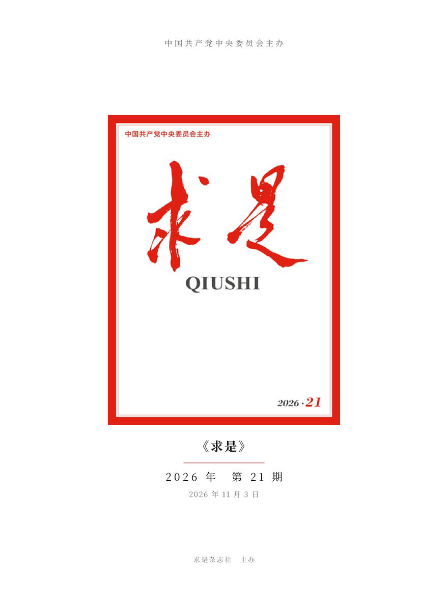
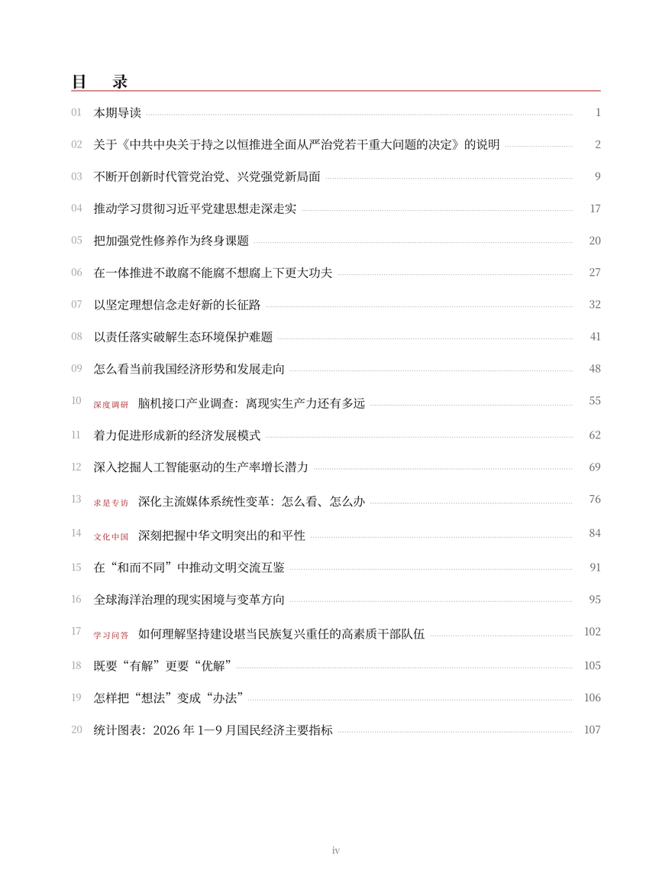

# 《求是》精排版 PDF 生成器

把 [求是网](http://www.qstheory.cn) 上某期《求是》抓下来，排成**一本真正的书**：封面、扉页、点线目录、页眉页脚、楷体图注，输出 3:4 的平板尺寸 PDF。附一个本地网页界面，选年份/期号点一下就能拿书。




> 截图仅示范版式；上面的文章标题与图片版权归求是杂志社/求是网，不在本仓库内。

## 它解决什么

网上的"下载器"大多是把网页 `printToPdf` 一下——A4 网页样、没有目录页码、图注丢失、每期版式不一。这个项目把内容**结构化**（段落 / 小标题 / 分节号 / 图 / 图注 / 表格），再用 [Typst](https://typst.app) 重新排版成书：

- **页面** 1152×1536 pt（3:4），平板上满屏阅读，不是 A4
- **字体** 思源宋体（Serif SC）Regular/Bold，正文 25.5pt、首行缩进 2 字、两端对齐
- **结构** 封面 → 扉页 → 编辑说明 → 目录（点线 + 真实页码）→ 正文（每篇起新页）→ 版权页
- **细节** 栏目红标、标题下压红细线、页眉「刊名 / 篇名」、页脚居中页码、图片浮动到页底且图注紧随、楷体图注、分节号居中
- **导航** PDF 大纲：每篇一级书签、每个小节二级书签

## 环境要求

| 依赖 | 说明 |
|---|---|
| Python 3.10+ | |
| [Typst](https://github.com/typst/typst) 0.13+ | `winget install --id Typst.Typst -e`，或从 release 下载 |
| 思源宋体 SC（可变字体） | 系统里装了即可；`make_fonts.py` 会从 VF 切静态字重 |
| [XHSecurity/Qiushi-Downloader](https://github.com/XHSecurity/Qiushi-Downloader) | 只借用它的"期号发现"，需自己 clone（见下） |

## 安装

```bash
git clone <本仓库> qiushi-book
cd qiushi-book
pip install -r requirements.txt

# 期号发现依赖（本项目不分发它的代码）
git clone https://github.com/XHSecurity/Qiushi-Downloader vendor/Qiushi-Downloader

# 从本机思源宋体 VF 切出 Regular/Bold 静态实例 → fonts/
python make_fonts.py
```

找不到上游仓库时，也可以 `set QIUSHI_REPO=D:\path\to\Qiushi-Downloader`。

## 用法

### 网页版（推荐）

```bash
cd web
start.bat          # Windows 双击即可；其它系统 python app.py
```

浏览器打开 <http://127.0.0.1:8720/>，选年份、期号 → 「开始生成」→ 完成后下载。

- 进度条按抓取篇数实时更新，日志可滚动查看
- 支持取消；同一期正在生成时不会重复开任务
- 「退出服务」或关掉命令行窗口即停止

### 命令行

```bash
python make.py                        # 最新一期
python make.py --issue 20             # 2026 年第 20 期（自动找目录页）
python make.py --year 2025 --issue 3
python make.py --url https://www.qstheory.cn/20261015/<id>/c.html
python make.py --issue 20 --out D:\books --force
```

分步执行：

```bash
python extract.py --issue 20 --imgdir img/2026-20 --out issue-2026-20.json
python build.py issue-2026-20.json book-2026-20.typ
typst compile book-2026-20.typ book-2026-20.pdf --font-path fonts
```

## 目录结构

```
qiushi-book/
├─ extract.py        抓取 + 结构化成 issue.json（段落/图注/小标题/图片）
├─ build.py          把 issue.json 生成 Typst 文档
├─ make.py           一条命令跑完 extract → build → typst compile
├─ make_fonts.py     从思源宋体 VF 生成静态字重
├─ paths.py          上游仓库 / 输出目录 / 字体文件的路径解析
├─ web/
│  ├─ app.py         本地网页服务（标准库 http.server，无第三方框架）
│  ├─ index.html     单页界面
│  ├─ list_issues.py 年份/期号列表（调上游仓库）
│  └─ start.bat      Windows 一键启动
└─ docs/             README 截图
```

运行时产生（已在 `.gitignore`）：`img/`（配图）、`issue*.json`、`book*.typ`、`output/`（成书 PDF）、`fonts/`。

## 已知限制

- 抓取依赖求是网现有页面结构；站点改版需要动 `extract.py` 里的正则
- 栏目名（深度调研、求是专访……）靠版式特征识别，个别期可能漏标
- 纯图片的"统计图表"只能整幅嵌入，无法还原成可编辑表格
- 需要能访问 qstheory.cn；请控制抓取频率，别给站点添麻烦

## 免责声明

- 本项目**只提供工具**，不包含《求是》任何一期的文章、图片或成书 PDF
- 抓取内容的版权归**求是杂志社 / 求是网**所有；生成的 PDF 仅供**个人学习、研究、离线阅读**
- **不得再分发、不得商用**；请遵守目标站点的 robots.txt 与服务条款
- 本项目与求是杂志社、求是网无任何隶属或授权关系，**非官方工具**
- 使用本项目产生的任何后果由使用者自负

## 许可

本项目代码采用 [MIT](LICENSE)，版权行 `Copyright (c) 2026 ZenXialai`。

运行时依赖的第三方组件（上游 Qiushi-Downloader 的 MIT、思源宋体的 OFL 1.1、Typst 的 Apache-2.0、Python 包）及其义务，见 [THIRD-PARTY-NOTICES.md](THIRD-PARTY-NOTICES.md)。

## 致谢

- [XHSecurity/Qiushi-Downloader](https://github.com/XHSecurity/Qiushi-Downloader)：期号与目录页发现
- [Typst](https://github.com/typst/typst)：排版引擎
- [思源宋体](https://github.com/adobe-fonts/source-han-serif)：中文字体
